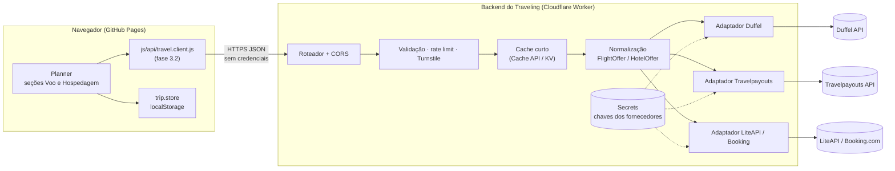

# Fase 3.1 — Arquitetura de integração com dados reais de viagem

> Documento de arquitetura e pesquisa. **Nenhuma integração foi implementada.** O Traveling não exibe hoje preços ao vivo de voos nem disponibilidade de hotéis. Pesquisa de fornecedores feita em 15/11/2026; itens marcados como **[confirmar]** dependem de contato comercial ou de páginas que não puderam ser lidas.

## Estado da implementação

**Fase 3.2 — fundação iniciada localmente (sem deploy, sem fornecedor real, sem chaves):**

| Entregue | Onde |
|---|---|
| Worker com as três rotas do §8, CORS restrito, limite de corpo, validação estrita, limite por cliente (/24 do IPv4, /48 do IPv6, sem guardar o IP), prazos, resultado parcial, cache curto com coalescência, disjuntor e logs sem dados pessoais | `backend/src/` |
| Modelos normalizados do §7 com verificação; ofertas fora do contrato são descartadas | `backend/src/models.js` |
| Fornecedor fictício declarado como teste (`dataSource: "test"`, sem fotos inventadas) | `backend/src/providers/mock.js` |
| IATA conferido com o mesmo `data/airports.json` do site | `backend/src/airports.generated.js` (`npm run build:backend-airports`) |
| Cliente do site, **desligado** sem `<meta name="traveling-api">`, que monta as buscas a partir da viagem | `js/api/travel.client.js` |
| Testes de ponta a ponta (backend + cliente) e auditorias de segredos e de preloads, no `npm run validate` | `scripts/validate-backend.js`, `validate-secrets.js`, `validate-page.js` |

**Decisões D1–D7 aprovadas em 15/11/2026.** Em seguida:

| Entregue (fase 3.3, parte de voos) | Onde |
|---|---|
| Adaptador Duffel conforme a documentação oficial (fusos convertidos para ISO 8601 com offset, bagagem, condições, expiração); ativo só com o Secret `DUFFEL_TOKEN`; token de teste → `dataSource: "test"`; só adultos (a Duffel exige idade dos menores) | `backend/src/providers/duffel.flights.js` |
| Seção "Buscar voos reais" na etapa Voo: busca a partir da viagem, ordenação, rótulos de procedência, expiração, "Adicionar à viagem" (cotação no orçamento) e "Na sua viagem" | `js/planner/live.flights.section.js` |
| Referência de oferta na viagem (`source.kind: "provider-offer"`), aditiva: **sem** mudança de versão do schema (o §11.4 previa v3; não foi preciso) | `js/planner/trip.model.js` |
| Rótulos novos `cached` ("Preço visto recentemente") e `test` ("Dados de teste") | `js/provenance.js` |
| Página de privacidade e aviso de afiliados (D7) | `privacidade.html` |
| Servidor local do backend para desenvolvimento, sem wrangler | `npm run dev:backend` |

Para publicar (precisa das contas, que são do responsável pelo projeto): criar a conta Cloudflare e rodar `npx wrangler deploy` em `backend/`; criar conta na Duffel e `npx wrangler secret put DUFFEL_TOKEN` com o token de **teste**; acrescentar `duffel` a `FLIGHT_PROVIDERS`; e incluir `<meta name="traveling-api" content="https://<worker>/api/v1">` no `index.html`. Travelpayouts, LiteAPI e afiliados Booking.com dependem do cadastro em cada programa.

## Sumário

1. [Auditoria da arquitetura atual](#1-auditoria-da-arquitetura-atual)
2. [Fornecedores de voos](#2-fornecedores-de-voos)
3. [Fornecedores de hospedagem](#3-fornecedores-de-hospedagem)
4. [Recomendação de fornecedores](#4-recomendação-de-fornecedores)
5. [Arquitetura de backend](#5-arquitetura-de-backend)
6. [Diagrama](#6-diagrama)
7. [Modelos de dados normalizados](#7-modelos-de-dados-normalizados)
8. [Contrato da API interna](#8-contrato-da-api-interna)
9. [Cache, desempenho e confiabilidade](#9-cache-desempenho-e-confiabilidade)
10. [Segurança, privacidade e requisitos comerciais](#10-segurança-privacidade-e-requisitos-comerciais)
11. [Integração com o Planner](#11-integração-com-o-planner)
12. [Complexidade estimada](#12-complexidade-estimada)
13. [Riscos e decisões em aberto](#13-riscos-e-decisões-em-aberto)
14. [Roteiro: fases 3.2 a 3.5](#14-roteiro-fases-32-a-35)

---

## 1. Auditoria da arquitetura atual

Fonte da verdade: o repositório na branch `main` (commit `ab4ff6c`), não a documentação antiga.

### 1.1 Plataforma e execução

| Item | Situação atual |
|---|---|
| Hospedagem | GitHub Pages, site estático. Sem `CNAME`, sem servidor, sem etapa de build. |
| Front-end | HTML + CSS + módulos ES nativos (`js/`), carregamento sob demanda com `import()`. |
| Dependências | Nenhuma no `package.json`. Three.js, TopoJSON e world-atlas vêm de CDN com versão fixa (import map em `index.html`). |
| Node | Só para scripts de dados e validação (`scripts/`, Node ≥ 20; CI usa Node 22). |
| CI | `.github/workflows/validate.yml` (validações offline e online em PR/push para `main`) e `airports.yml` (reprodutibilidade de `data/airports.json`). Nenhum workflow de deploy: o Pages publica a branch diretamente. |
| Chamadas externas em tempo real | Apenas a API PTAX do Banco Central (`js/fx.service.js`), pública, chamada direto do navegador, com fallback em `data/fx-snapshot.json`. |
| CSP | Não há `Content-Security-Policy` em `index.html`. |
| Segredos | Nenhum. Não há onde guardá-los com segurança no modelo atual. |

### 1.2 Planner

| Arquivo | Papel | Reaproveitar na integração |
|---|---|---|
| `js/planner/planner.ui.js` (972 linhas) | Painel com seis etapas (`PLANNER_STEPS`: Destino, Datas, Voo, Estilo, Preparação, Resumo). Tudo por escolhas; rascunho (`startDraft`) antes de criar a viagem. | **Sim.** As etapas aceitam **seções plugáveis** (`sections: { id, step, render, bind, refresh }`). Busca de voos e de hotéis entram como novas seções, sem reescrever o Planner. |
| `js/planner/flight.section.js` | Seção da etapa Voo: resolve origem (`airportRepository.resolve`) e destino (aeroporto da cidade via `resolveCityAirport` ou do país), calcula **estimativa** (`estimateRoute`) e comparação com milhas; botão de rota no globo (`onPreviewRoute`). | **Sim.** A resolução de aeroportos e a estimativa continuam; a busca ao vivo vira uma seção irmã. |
| `js/planner/trip.model.js` | Modelo puro, validado em `scripts/validate-planner.js`. Viagem com `countryKey`, `city {id,name,lat,lng,region}`, `origin` (IATA/ICAO 3–4 caracteres), `cabin`, datas `AAAA-MM-DD`, `travelers` (1–9), `lodging`, escolhas, `checklist`, e **`lines`** (itens de orçamento com `category`, `amountBRL`, `currency`/`amount`/`fx`, `status` estimate/quote/paid e `source`). Schema v2. | **Sim.** `lines` é o lugar natural para anexar um voo ou hotel escolhido (ver §11.4). O schema precisará de v3 só para novos campos de `source`. |
| `js/planner/trip.store.js` | Persistência em `localStorage` (`traveling.trips`), migração com backup, sem conta e sem servidor. | **Sim.** Ofertas escolhidas entram na viagem como snapshot pequeno; listas de resultados **não** são persistidas. |
| `js/planner/planner.estimates.js`, `currency.js`, `money.js` | Cálculo de estimativas, conversão de moeda (PTAX), formatação. | **Sim.** Conversão para BRL de preços em outra moeda, sempre a partir do valor original. |
| `js/planner/prep.section.js` | Etapa Preparação (entrada, checklist). | Sem alteração. |

### 1.3 Aeroportos, rotas e preços

| Arquivo | Papel | Observação para a integração |
|---|---|---|
| `js/airports.repository.js` + `data/airports.json` | ~9.000 aeroportos com IATA (gerado de `datasets/airport-codes`, commit fixo). `resolve(code)` aceita IATA e ICAO; `search`, `findNearest`, `findGateway(lat,lng)` (aeroporto principal até 150 km, senão ICAO padrão até 100 km). | Fornecedores de voo trabalham com **IATA**. O front já converte ICAO→IATA via repositório; o backend deve **revalidar** com o mesmo dataset. |
| `js/pricing.engine.js` | Estimativa por distância, mês e cabine (faixas em USD → BRL pela PTAX). Não é cotação. | Continua como referência e fallback (§11.5). |
| `js/flight.route.js`, `js/flight.visualization.js` | Arco de grande círculo e avião no globo, origem→destino. | Ofertas com conexões poderão desenhar trechos (fase futura); hoje é um arco único. |
| `js/drawer/flights.tab.js` | Aba Voos do país (`estimateRoute`, `resolveDestinationAirport`). | Mesmo motor de estimativa. |
| `js/provenance.js` | Etiqueta única de procedência: `verified`, `live` ("Ao vivo", **ainda não usado**), `estimate`, `calculated`, `unverified`. | Base do sistema de rótulos ao vivo × estimativa (§11.5). |

### 1.4 Destinos e passagem para o Planner

- `planTrip(countryKey, { city })` em `js/app.js` abre o Planner com país e cidade (vindos do globo, do cartão de cidade ou da Descoberta).
- Cidades: `js/geo/cities.js` (data/admin, com coordenadas, região e fuso) e `js/saved.store.js` (destinos salvos com id estável, nome, coordenadas e `geonameId` quando existe).
- **Consequência:** a busca de hotéis pode usar as **coordenadas da cidade** já presentes na viagem (`trip.city.lat/lng`), que é exatamente o formato aceito por fornecedores como Duffel Stays (raio em km).

### 1.5 Testes e validações existentes

`npm run validate` (18 auditorias offline, incluindo `validate-planner.js`, `validate-saved.js`, `validate-provenance.js`, `validate-fx.js`) e `npm run validate:online`. Novos módulos puros (validação de requisição, normalização de ofertas) devem seguir o mesmo padrão: funções puras testadas em Node.

### 1.6 Conclusões da auditoria

1. O front pode permanecer no GitHub Pages; falta **apenas** uma camada de backend para guardar credenciais e falar com fornecedores.
2. Nada precisa ser redesenhado: seções plugáveis, `lines` com `source`, `provenance.js` e `fx.service.js` já cobrem integração, orçamento, rótulos e moeda.
3. Lacunas: não há cliente HTTP para um backend próprio, não há CSP, e o modelo de `source` só aceita `traveling-estimate` e `user`.

---

## 2. Fornecedores de voos

Distinções usadas abaixo: **busca** (consultar ofertas), **comparação de preços** (metabusca entre vendedores), **reserva** (criar pedido) e **emissão** (bilhete emitido). Ter busca não implica poder vender.

### 2.1 Amadeus for Developers — **inviável para começar**

| Ponto | Situação | Verificação |
|---|---|---|
| Status | O portal **Self-Service foi descontinuado em 17/07/2026**; chaves self-service deixaram de funcionar. Os SDKs oficiais foram arquivados nesse dia (ex.: [amadeus4dev/amadeus-node](https://github.com/amadeus4dev/amadeus-node): "archived by the owner on Jul 17, 2026"). | Verificado (SDK oficial arquivado) + imprensa ([PhocusWire](https://www.phocuswire.com/amadeus-shut-down-self-service-apis-portal-developers)) |
| Acesso hoje | Apenas **Enterprise**, que exige contrato comercial. | Relatos secundários; site oficial não pôde ser lido (renderização no cliente) **[confirmar]** |
| Busca / reserva / emissão | Enterprise cobre busca e reserva; emissão depende de contrato com agência/consolidador. | **[confirmar]** |
| Sandbox | O sandbox self-service saiu do ar junto com o portal. | Relatos secundários |

**Conclusão:** a "Amadeus for Developers" que a fase 3.1 pedia para avaliar não está mais disponível para um projeto sem contrato Enterprise.

### 2.2 Duffel — **único com busca em tempo real e cadastro direto**

| Ponto | Situação | Verificação |
|---|---|---|
| O que é | API de **busca e reserva** (o integrador vira o vendedor). Busca: `offer requests` com `slices` (origem, destino, data), `passengers` (adulto ou idade) e `cabin_class`. Pedido: endpoint separado, a partir de uma oferta. | Verificado ([guia de voos](https://duffel.com/docs/guides/getting-started-with-flights)) |
| Dados da oferta | `total_amount`/`total_currency`, `base_amount`, `tax_amount`, `owner` (cia.), `slices` → `segments` com `departing_at`, `arriving_at`, `duration`, `marketing_carrier`, `operating_carrier`, `stops`; bagagem por passageiro (`baggages`); `conditions` (reembolso/alteração e multas); **`expires_at`** (ofertas duram tipicamente ~30 min); `GET /air/offers/{id}` atualiza a oferta. | Verificado ([referência de Offers](https://duffel.com/docs/api/v2/offers)) |
| Atualidade | Ofertas vêm das companhias no momento da busca; o preço **não é garantido** até o pedido. | Verificado (referência) |
| Sandbox | **Test mode** com token `duffel_test_` e a companhia fictícia **Duffel Airways (ZZ)**; horários e preços **não realistas**. | Verificado ([test mode](https://duffel.com/docs/api/overview/test-mode)) |
| Produção | Passagem para live mode **não descrita** na documentação lida. | **[confirmar]** |
| Preço | US$ 3 por pedido confirmado; 1% do valor em "Managed Content"; US$ 2 por adicional pago; **taxa de busca excedente US$ 0,005 por busca** acima da proporção **1.500 buscas : 1 pedido**; câmbio 2% quando há conversão. Sem mensalidade. | Verificado ([pricing](https://duffel.com/pricing)) |
| Link de reserva externo | **Não existe**: a oferta é comprável pela própria Duffel, não por um link para a companhia. | Verificado (modelo de pedido) |
| Cobertura | Muitas companhias via NDC/GDS; lista exata e cobertura de rotas brasileiras **[confirmar]**. | **[confirmar]** |

**Atenção comercial:** usar a Duffel **só para mostrar preços**, sem vender, gera taxa por busca (ex.: 10.000 buscas sem pedidos ≈ US$ 50/mês, ordem de grandeza **[confirmar]** a regra exata da proporção com zero pedidos) e não oferece link de redirecionamento. A Duffel faz sentido pleno quando o Traveling decidir **vender** passagens, o que envolve pagamentos, atendimento, responsabilidade por alterações e questões legais (§10.6).

### 2.3 Travelpayouts / Aviasales — **afiliado, preços em cache, redirecionamento**

| Ponto | Situação | Verificação |
|---|---|---|
| O que é | Rede de afiliados. A **Data API** devolve preços **em cache**, formados a partir de buscas recentes de usuários da Aviasales, guardados por **2 a 7 dias** conforme o tipo de consulta. Monetização por comissão em reservas feitas pelo link de afiliado. | Verificado ([Aviasales Data API](https://support.travelpayouts.com/hc/en-us/articles/203956163)) |
| Busca em tempo real | A **Flight Search API** em tempo real só é liberada a projetos com **50.000+ usuários ativos/mês**. | Verificado (central de ajuda Travelpayouts, citação da página) |
| Acesso | Cadastro de parceiro + programa Aviasales. Requisitos e limites detalhados: a página de requisitos retornou 403 **[confirmar]**. | Parcial |
| Uso adequado | Ótimo para "preço visto recentemente" + link de busca/reserva; **nunca** como preço ao vivo. | — |

### 2.4 Outros avaliados (não recomendados agora)

| Fornecedor | Situação | Fonte |
|---|---|---|
| Skyscanner Travel API | Só para empresas estabelecidas com **>100 mil visitas/mês**, com análise caso a caso. | [Critérios oficiais](https://skyscannerpartnersupport.zendesk.com/hc/en-us/articles/10881149122717-What-is-the-acceptance-criteria-for-the-Travel-API) |
| Kiwi.com Tequila | Acesso por parceria selecionada; cadastro público fechado (relato secundário). | [Kiwi.com media](https://media.kiwi.com/articles-and-interviews/better-for-business-kiwi-com-takes-a-new-approach-to-partnerships/) **[confirmar]** |

---

## 3. Fornecedores de hospedagem

Distinções: **base de propriedades** (dados estáticos: nome, fotos, comodidades), **resultado de busca** (propriedades que atendem a um filtro), **disponibilidade em tempo real** (quartos e tarifas para as datas), **oferta reservável** (tarifa que pode virar reserva, normalmente após uma cotação) e **link de reserva externo**. Dados estáticos nunca provam disponibilidade.

### 3.1 Amadeus Hotel APIs — **inviável para começar**

Mesma situação do §2.1: as APIs de hotel self-service saíram do ar em 17/07/2026; resta o Enterprise com contrato **[confirmar condições]**.

### 3.2 Booking.com Demand API — **melhor conteúdo, acesso fechado**

| Ponto | Situação | Verificação |
|---|---|---|
| Acesso | Exige ser **Managed Affiliate Partner**, com **contrato assinado** e acesso ao Partner Centre liberado pelo gerente de conta; credenciais = token + `X-Affiliate-Id`, que **não podem ir para controle de versão**. | Verificado ([pré-requisitos](https://developers.booking.com/demand/docs/getting-started/prerequisites)) |
| Sandbox | Existe (guia de Sandbox), mas só depois do contrato. | Verificado (mesma página) |
| Conteúdo | Acomodações, atrações e carros; endpoints de pedidos (detalhes, modificar, cancelar) na versão 3.1; avaliações aparecem na **3.2 beta** (exemplo encontrado: atrações), oferecida a parceiros piloto. Detalhes de busca/disponibilidade de acomodação **[confirmar]** na referência. | Verificado (índices da [3.1](https://developers.booking.com/demand/docs/open-api/3.1/demand-api) e da [3.2 beta](https://developers.booking.com/demand/docs/open-api/3.2-beta/demand-api)) |
| Reserva via API | Não esclarecido na página de pré-requisitos; relatos indicam aprovação contratual separada. | **[confirmar]** |
| Imagens, avaliações, preços, taxas, cancelamento | Disponíveis na API; regras de exibição/uso de imagens dependem do contrato. | **[confirmar]** |

### 3.3 Duffel Stays

| Ponto | Situação | Verificação |
|---|---|---|
| Acesso | Conta Duffel + **pedido de acesso** ao Stays (contato comercial). | Verificado ([guia de Stays](https://duffel.com/docs/guides/getting-started-with-stays)) |
| Busca | Por **coordenadas + raio (km)** ou por IDs; `check_in_date`, `check_out_date`, `rooms`, `guests`. Retorna a tarifa mais barata por propriedade. | Verificado |
| Fluxo | busca → todas as tarifas (`rate_id`) → **cotação** (`quote_id`, confirma disponibilidade) → reserva (dados do hóspede). | Verificado |
| Preço | Participação nos lucros por estadia concluída (sem taxa fixa publicada). | Verificado ([pricing](https://duffel.com/pricing)) |
| Fotos, avaliações, comodidades, cancelamento | Campos exatos não confirmados na página lida. | **[confirmar]** |
| Link externo | Não: modelo de venda pela própria Duffel. | Verificado (fluxo de reserva) |

### 3.4 LiteAPI (Nuitée) — **sandbox self-service**

| Ponto | Situação | Verificação |
|---|---|---|
| Acesso | Conta gratuita, **sandbox "production-like" sem cartão**; produção exige cartão e carteira com saldo. | Verificado ([dev.liteapi.travel](https://dev.liteapi.travel/), [FAQ](https://docs.liteapi.travel/docs/faq)) |
| Fluxo | Busca de tarifas → prebook → book. Há endpoint de **preço público em cache**. | Verificado ([referência](https://docs.liteapi.travel/reference)) |
| Limites | Ex.: endpoint de preços com **10 req/min** (sandbox e produção). | Verificado (referência, citação de terceiros conferida no índice) **[confirmar demais]** |
| Planos e comissão | Página de planos não lida. | **[confirmar]** |
| Link externo | Modelo de venda (o integrador reserva). | Verificado (fluxo) |

### 3.5 Outros avaliados

| Fornecedor | Situação | Fonte |
|---|---|---|
| Expedia Rapid | Exige ser **parceiro Expedia** e cumprir requisitos de lançamento (B2C/B2B); uso de marca só com autorização escrita. | [Developer Hub](https://developers.expediagroup.com/docs/products/rapid/setup/getting-started), [B2C](https://developers.expediagroup.com/rapid/setup/launch-requirements/b2c-standalone) |
| Links de afiliado Booking.com (sem API) | Programa de afiliados com links de busca para cidade e datas, **sem preços no Traveling**. Termos do programa **[confirmar]**. | — |

---

## 4. Recomendação de fornecedores

### 4.1 Diagnóstico

Os dois fornecedores que a fase pedia para avaliar estão **fechados** para o Traveling hoje: Amadeus (self-service encerrado) e Booking.com Demand API (contrato de afiliado gerenciado). As opções abertas dividem-se em dois modelos de negócio que **não podem ser misturados na comunicação ao usuário**:

| Modelo | Exemplos | O que o usuário vê | Responsabilidade do Traveling |
|---|---|---|---|
| **A. Indicar e redirecionar** (afiliado/metabusca) | Travelpayouts/Aviasales (voos), links de afiliado Booking.com (hotéis) | Preço **recente em cache** ou só o link; reserva no site do parceiro | Divulgar afiliação; não promete preço |
| **B. Vender** (agência online) | Duffel (voos e Stays), LiteAPI, Booking/Expedia sob contrato | Preço **ao vivo** e reservável | Pagamento, atendimento, alterações, cancelamentos, obrigações legais |

A fase 3.1 pede preferência por **redirecionamento** até haver uma integração de reserva aprovada. Isso aponta para o modelo A em produção, com o modelo B preparado tecnicamente, mas desligado.

### 4.2 Recomendação

1. **Voos, produção inicial: Travelpayouts/Aviasales Data API.** Gratuito com cadastro, com link de redirecionamento e monetização por comissão. Exibir **sempre** como "Preço visto recentemente" com a data, nunca como "Ao vivo". Antes: confirmar termos de exibição, limites e cache **[confirmar]**.
2. **Voos ao vivo: Duffel**, desenvolvida em **test mode** desde a fase 3.2 para validar o contrato interno com respostas reais de API. Só ligar em produção se o projeto decidir vender passagens (decisão D2, §13). É o único fornecedor com busca em tempo real e cadastro direto.
3. **Hotéis, produção inicial: links de afiliado Booking.com** (cidade + datas + hóspedes, sem preços no Traveling) e, para preços, **LiteAPI em sandbox** para construir o adaptador. Ligar preços reais só após decidir o modelo (A ou B) e ler os termos.
4. **Hotéis, longo prazo: Booking.com Demand API**, se o Traveling conseguir o contrato de afiliado gerenciado. Melhor conteúdo (fotos, avaliações, políticas), já com sandbox oficial.

Popularidade não pesou: Amadeus e Skyscanner são os nomes mais conhecidos e são exatamente os inacessíveis.

---

## 5. Arquitetura de backend

### 5.1 Requisito central

O GitHub Pages é estático e público: **nenhuma credencial pode existir no front-end**, nem em JS, HTML, JSON públicos, repositório, requisições do navegador ou variáveis de build. Toda chamada a fornecedor passa por um backend que guarda os segredos.

### 5.2 Opções comparadas

| Critério | **Cloudflare Workers** | Vercel Functions | Netlify Functions |
|---|---|---|---|
| Plano gratuito | 100.000 req/dia, 1.000 req/min de pico; **10 ms de CPU** por requisição, mas **espera de rede não conta** (busca em fornecedor é espera) | Hobby: **uso pessoal, não comercial** (links de afiliado contam como comercial) | Créditos mensais; o site é **pausado** quando acabam (relato secundário) |
| Segredos | Secrets por Worker (até 64 variáveis no free) | Env vars | Env vars |
| CORS | Controle total no código | Total | Total |
| Convive com o GitHub Pages | Sim, domínio próprio do Worker (`*.workers.dev` ou rota própria) | Sim | Sim |
| Cache/estado | Cache API e KV nativos | KV/Edge Config (planos pagos) | Blobs |
| Logs | `wrangler tail`, Workers Logs | Painel | Painel |
| Manutenção | Uma função pequena, sem servidor, deploy por CLI | Idem | Idem |

Fontes: [limites Cloudflare](https://developers.cloudflare.com/workers/platform/limits), [preços Cloudflare](https://developers.cloudflare.com/workers/platform/pricing/), [Vercel Hobby](https://vercel.com/docs/plans/hobby). Limites detalhados de Netlify **[confirmar]**.

### 5.3 Recomendação: Cloudflare Workers

- Plano gratuito compatível com uso comercial e afiliados; o limite de CPU não atrapalha porque o tempo de espera do fornecedor não conta.
- O front continua no GitHub Pages, sem migração e sem build.
- Cache API/KV para cache de curta duração e rate limiting.
- Código em JavaScript moderno: o mesmo estilo de módulos puros do projeto, testável em Node, sem framework.

### 5.4 Estrutura proposta (para a fase 3.2, não criada agora)

```
backend/                      # projeto do Worker, separado do site estático
  src/
    index.js                  # roteamento, CORS, limites
    validate.js               # validação de requisições (pura, testada em Node)
    normalize/flight.js       # modelos normalizados (§7)
    normalize/hotel.js
    providers/
      provider.js             # interface comum do adaptador
      mock.js                 # respostas fixas para desenvolvimento e testes
      duffel.flights.js       # test mode na 3.2/3.3
      travelpayouts.flights.js
      liteapi.hotels.js
  test/                       # testes de contrato com respostas gravadas (sem chaves)
  wrangler.toml               # configuração sem segredos (segredos via `wrangler secret put`)
```

### 5.5 Validação, erros e abuso

- **Validação de entrada:** esquema estrito (§8); rejeita campos desconhecidos; IATA validado contra a mesma base de `data/airports.json` (subconjunto embutido no Worker, a confirmar tamanho de pacote); datas reais, no futuro, ida ≤ volta, janela máxima (ex.: até 330 dias); passageiros 1–9; quartos 1–4.
- **Erros de fornecedor:** cada adaptador traduz erros para códigos internos (`PROVIDER_TIMEOUT`, `PROVIDER_UNAVAILABLE`, `NO_RESULTS`, `INVALID_ROUTE`…); o front nunca vê a mensagem crua do fornecedor.
- **Abuso:** CORS restrito à origem do site (o GitHub Pages do projeto); rate limit por IP com janela curta (ex.: 10 buscas/min, 100/dia) guardado no KV ou no recurso de rate limiting da Cloudflare; limite global diário por fornecedor abaixo da cota contratada; **Cloudflare Turnstile** (desafio invisível) se houver abuso; corpo máximo pequeno (2 KB).

---

## 6. Diagrama



Versão em texto: **Front-end Traveling → Backend/API do Traveling (Worker) → Adaptadores de fornecedor → APIs externas de voos e hotéis.** Credenciais existem apenas no Worker.

---

## 7. Modelos de dados normalizados

Regras gerais: datas e horas em **ISO 8601**; preços como **decimal em string** (evita erro de ponto flutuante) com código **ISO 4217** explícito; campos opcionais **ausentes** (não `0`, não string vazia) quando o fornecedor não informar; nenhum dado inventado.

### 7.1 Oferta de voo — `FlightOffer`

```jsonc
{
  "kind": "flight-offer",
  "provider": "duffel",                     // obrigatório
  "offerId": "off_0000...",                 // obrigatório, opaco
  "dataSource": "live",                     // "live" | "cached" | "test" (obrigatório)
  "searchedAt": "2026-11-15T13:02:11Z",     // obrigatório
  "observedAt": "2026-11-12T08:00:00Z",     // opcional: quando o preço em cache foi visto
  "expiresAt": "2026-11-15T13:32:11Z",      // opcional (Duffel informa)
  "passengers": { "adults": 2, "children": 0, "infants": 0 },
  "cabin": "economy",                       // opcional
  "price": {
    "total": "8420.50", "currency": "BRL",  // obrigatório: total para TODOS os passageiros
    "base": "7100.00", "taxes": "1320.50"   // opcionais
  },
  "slices": [                               // 1 (só ida) ou 2 (ida e volta)
    {
      "origin": "GRU", "destination": "LIS",
      "departAt": "2027-04-02T22:10:00-03:00",   // horário LOCAL com offset do aeroporto
      "arriveAt": "2027-04-03T12:05:00+01:00",
      "durationMinutes": 595,
      "stops": 0,
      "connections": [],                    // IATA das conexões
      "segments": [
        {
          "origin": "GRU", "destination": "LIS",
          "departAt": "2027-04-02T22:10:00-03:00", "arriveAt": "2027-04-03T12:05:00+01:00",
          "marketingCarrier": { "iata": "TP", "name": "TAP Air Portugal" },
          "operatingCarrier": { "iata": "TP", "name": "TAP Air Portugal" },
          "flightNumber": "TP88"
        }
      ]
    }
  ],
  "baggage": [{ "type": "checked", "quantity": 1, "per": "passenger" }],   // opcional
  "conditions": {                                                         // opcional
    "refundable": false,
    "changeable": true, "changePenalty": { "amount": "450.00", "currency": "BRL" }
  },
  "bookingUrl": "https://...",              // opcional: só fornecedores de redirecionamento
  "status": "available"                     // "available" | "expired" | "unconfirmed"
}
```

### 7.2 Hospedagem: propriedade × oferta

**Propriedade (estática) — `HotelProperty`**

```jsonc
{
  "kind": "hotel-property",
  "provider": "liteapi",
  "propertyId": "lp1234",
  "name": "Hotel Exemplo",
  "location": { "city": "Lisboa", "countryCode": "PT", "address": "Rua ...", "lat": 38.71, "lng": -9.14 },
  "rating": { "stars": 4, "reviewScore": 8.6, "reviewScale": 10, "reviewCount": 1520 },  // todos opcionais
  "images": [{ "url": "https://...", "source": "liteapi", "license": "provider-terms" }], // opcional
  "amenities": ["wifi", "breakfast"],      // opcional, vocabulário interno
  "description": "...",                    // opcional
  "fetchedAt": "2026-11-15T13:02:11Z"
}
```

**Oferta (disponibilidade para datas) — `HotelOffer`**

```jsonc
{
  "kind": "hotel-offer",
  "provider": "liteapi",
  "offerId": "rate_abc",
  "propertyId": "lp1234",
  "dataSource": "live",                    // "live" | "cached" | "test"
  "searchedAt": "2026-11-15T13:02:11Z",
  "expiresAt": null,                        // quando informado
  "checkIn": "2027-04-03", "checkOut": "2027-04-10",   // datas locais, sem fuso
  "nights": 7, "guests": { "adults": 2, "children": 0 }, "rooms": 1,
  "room": { "name": "Duplo standard", "beds": "1 cama de casal" },   // opcional
  "board": "room-only",                    // opcional: room-only | breakfast | half-board | full-board | all-inclusive
  "price": {
    "total": "4900.00", "currency": "EUR",  // obrigatório: estadia inteira
    "perNight": "700.00",                   // opcional: calculado só se o fornecedor não der e total/noites for exato
    "taxesIncluded": true,                  // opcional
    "feesAtProperty": { "amount": "14.00", "currency": "EUR", "note": "taxa turística" }  // opcional
  },
  "cancellation": { "refundable": true, "freeUntil": "2027-04-01T23:59:00+01:00", "text": "..." },  // opcional
  "availability": "available",             // "available" | "on-request" | "unconfirmed" | "sold-out"
  "reservationUrl": "https://..."          // opcional: redirecionamento
}
```

### 7.3 Regras de qualidade

| Situação | Regra |
|---|---|
| Informação ausente | Campo omitido; a UI mostra "não informado pelo fornecedor", nunca um valor padrão. |
| Moedas diferentes | Guardar sempre o valor e a moeda **originais**; a conversão para BRL é só exibição, via `fx.service.js` (PTAX), com a data da cotação. Nunca somar moedas diferentes sem converter. |
| Datas e horas | Voos: horário local com offset ISO 8601 (o que o passageiro vê no bilhete). Hotéis: datas locais `AAAA-MM-DD`. Carimbos do sistema (`searchedAt`, `expiresAt`) em UTC (`Z`). |
| Fusos | Duração calculada pelos instantes absolutos, nunca pela diferença de horários locais. |
| Duplicados | Chave = fornecedor + cia. + números de voo + horários + cabine; mantém o menor preço e registra os demais fornecedores. Hotéis: mesmo `propertyId` + quarto + regime + cancelamento. |
| Aeroporto inválido | Rejeitado no backend (`INVALID_AIRPORT`) antes de chamar o fornecedor. ICAO convertido para IATA no front (repositório existente) e revalidado no backend. |
| Oferta indisponível/expirada | `status: "expired"`; a UI pede nova busca e **não** mostra o preço antigo como atual. |
| Erro de fornecedor | Código interno + mensagem amigável; sem detalhes técnicos do fornecedor. |
| Estruturas de preço diferentes | Total da viagem/estadia sempre presente e comparável; base, taxas e por noite apenas quando o fornecedor informa (ou cálculo exato e marcado como calculado). |

---

## 8. Contrato da API interna

Base: `https://<worker>/api/v1`. JSON UTF-8. Todas as respostas trazem `requestId` (para suporte) e nunca expõem dados do fornecedor fora do modelo normalizado.

### 8.1 `POST /api/v1/flights/search`

**Requisição**

```jsonc
{
  "origin": "GRU",                // obrigatório, IATA de aeroporto ou cidade
  "destination": "LIS",           // obrigatório, IATA, ≠ origem
  "departureDate": "2027-04-02",  // obrigatório, ≥ hoje, ≤ hoje + 330 dias
  "returnDate": "2027-04-10",     // opcional, ≥ departureDate
  "passengers": { "adults": 2, "children": 0, "infants": 0 },  // adultos 1–9; bebês ≤ adultos; total ≤ 9
  "cabin": "economy",             // opcional: economy | premium | business | first
  "currency": "BRL",              // opcional: moeda preferida (o fornecedor pode ignorar)
  "maxResults": 20                // opcional, 1–50
}
```

**Resposta 200**

```jsonc
{
  "requestId": "req_...",
  "status": "ok",                       // "ok" | "partial" (algum fornecedor falhou)
  "searchedAt": "2026-11-15T13:02:11Z",
  "providers": [{ "id": "duffel", "status": "ok", "dataSource": "live" }],
  "offers": [ /* FlightOffer[] ordenadas por preço total */ ],
  "warnings": ["Preços sujeitos a alteração até a reserva."]
}
```

### 8.2 `POST /api/v1/hotels/search`

```jsonc
{
  "destination": { "lat": 38.7223, "lng": -9.1393, "radiusKm": 10, "label": "Lisboa" },  // obrigatório (coordenadas da cidade da viagem)
  "checkIn": "2027-04-03",         // obrigatório, ≥ hoje
  "checkOut": "2027-04-10",        // obrigatório, > checkIn, ≤ 30 noites
  "guests": { "adults": 2, "children": 0, "childAges": [] },  // adultos 1–9 por busca
  "rooms": 1,                      // 1–4, rooms ≤ adults
  "currency": "BRL",               // opcional
  "maxResults": 20                 // opcional, 1–50
}
```

Resposta 200: `{ requestId, status, searchedAt, providers, properties: HotelProperty[], offers: HotelOffer[], warnings }`, com as ofertas apontando para `propertyId`.

### 8.3 `GET /api/v1/providers/status`

```jsonc
{
  "requestId": "req_...",
  "providers": [
    { "id": "duffel", "kind": "flights", "mode": "test", "status": "operational", "dataSource": "test" },
    { "id": "travelpayouts", "kind": "flights", "mode": "live", "status": "degraded", "dataSource": "cached" }
  ]
}
```

O front usa esse endpoint para decidir o que mostrar (ex.: esconder busca ao vivo se nenhum fornecedor `live` estiver operacional).

### 8.4 Erros

```jsonc
// 400, 404, 409, 422, 429, 502, 503, 504
{ "requestId": "req_...", "error": { "code": "INVALID_DATES", "message": "A volta precisa ser depois da ida.", "field": "returnDate", "retryable": false } }
```

| HTTP | Código | Quando |
|---|---|---|
| 400 | `INVALID_REQUEST`, `INVALID_AIRPORT`, `INVALID_DATES`, `INVALID_PASSENGERS` | Validação |
| 422 | `INVALID_ROUTE`, `UNSUPPORTED_CABIN` | Combinação não atendida |
| 429 | `RATE_LIMITED` (+ cabeçalho `Retry-After`) | Limite do Traveling ou do fornecedor |
| 502 | `PROVIDER_ERROR` | Resposta inválida do fornecedor |
| 503 | `PROVIDER_UNAVAILABLE`, `SEARCH_DISABLED` | Fornecedor fora ou busca desligada |
| 504 | `PROVIDER_TIMEOUT` | Estourou o prazo (§9) |

Sem resultados é **200** com `offers: []` e `warnings`, não erro.

### 8.5 Prazos

- Prazo total por busca: **12 s** de voo, **10 s** de hotel; prazo por fornecedor um pouco menor, para devolver `partial` com o que chegou.
- O front mostra progresso após 1 s e oferece cancelar (AbortController).

---

## 9. Cache, desempenho e confiabilidade

| Dado | Duração máxima no cache do Traveling | Motivo |
|---|---|---|
| Ofertas de voo ao vivo | **até 5 min** e nunca além de `expiresAt` | Preço muda rápido; ofertas Duffel duram ~30 min |
| Preços em cache de afiliado | Respeitar a data de observação do fornecedor; cache local de **até 1 h** | Já são preços antigos (2–7 dias); só evita repetir a mesma consulta |
| Disponibilidade de hotel | **até 5 min** | Disponibilidade e preço mudam |
| Dados estáticos de propriedade (nome, fotos, comodidades) | **até 24 h**, se os termos permitirem **[confirmar]** | Mudam pouco |
| Status de fornecedores | 60 s | — |

- **Chave de cache:** hash da requisição normalizada (rota, datas, passageiros, cabine, moeda). Nunca inclui dados pessoais.
- **Buscas repetidas e concorrentes:** requisições idênticas em andamento são coalescidas (uma ida ao fornecedor, várias respostas).
- **Retentativas:** só para erros transitórios (timeout, 5xx do fornecedor), **uma vez**, com espera curta e aleatória; nunca para 4xx; nunca além do prazo total.
- **Circuit breaker:** após falhas seguidas, o fornecedor fica `degraded` por alguns minutos e o status informa o front.
- **Fallback:** sem fornecedor disponível, o Planner continua mostrando a **estimativa** existente, rotulada como estimativa, com um aviso de que a busca está indisponível.
- **No navegador:** resultados vivem só na memória da sessão; nada de resultados no `localStorage`.
- **Comunicação de dados antigos:** sempre "Atualizado há X min"; após o prazo ou `expiresAt`, o cartão fica esmaecido com "Preço expirado: buscar de novo".

---

## 10. Segurança, privacidade e requisitos comerciais

### 10.1 Credenciais
- Só como **Secrets do Worker** (`wrangler secret put`); `wrangler.toml` e o repositório sem segredos; chaves de test e live separadas; rotação documentada.
- Validação de CI (fase 3.2): checagem que falha se padrões de chave (`duffel_live_`, `duffel_test_`, tokens longos) aparecerem em arquivos versionados.

### 10.2 CORS e requisições
- `Access-Control-Allow-Origin` só para a origem do site (e `localhost` em desenvolvimento); métodos `GET, POST, OPTIONS`; sem cookies.
- Validação estrita (§8), limite de corpo, rejeição de campos desconhecidos.

### 10.3 Abuso e limites
- Rate limit por IP + limite global diário por fornecedor; `429` com `Retry-After`; Turnstile se necessário; registro de picos.

### 10.4 Logs e privacidade
- Logar `requestId`, rota, códigos de erro, tempos e fornecedor. **Não** logar IP completo (ou só truncado/hash), nem nomes, e-mails ou dados de passageiros (que nem existem nas buscas desta fase).
- O Traveling **não coleta nem armazena** dados de cartão. Buscas não exigem conta; viagens continuam só no navegador.
- Página de privacidade explicando que buscas passam pelo backend e pelo fornecedor citado.

### 10.5 Termos, atribuição e imagens
- Exibir o nome do fornecedor de cada resultado ("Preço via …").
- Imagens de hotel: usar só as URLs do fornecedor, dentro dos termos (sem copiar para o repositório ou CDN própria **[confirmar por contrato]**); manter crédito quando exigido.
- Afiliados: aviso visível ("O Traveling pode receber comissão por reservas feitas por estes links, sem custo extra para você").

### 10.6 Reserva e responsabilidade
- Fora do escopo desta fase. Até haver integração de reserva aprovada, o Traveling **só redireciona** para páginas autorizadas do parceiro.
- Vender passagens/hospedagem (modelo B) implica pagamentos (PCI), atendimento, alterações e cancelamentos, e pode exigir enquadramento legal como agência de turismo no Brasil. Exige avaliação jurídica **antes** de ligar qualquer reserva **[confirmar com assessoria]**.

---

## 11. Integração com o Planner

Princípio: **não redesenhar**. Tudo entra como seções plugáveis nas etapas existentes, com a identidade visual (vidro, temas claro/escuro) e os componentes já usados (`choice`, `planner-card`, `provenance`).

### 11.1 Voo (etapa 3)

```
┌ Como você vai chegar? ─────────────────────────────────────┐
│ [Dinheiro] [Milhas] [Ainda não sei]   [Econômica] [...]    │  ← escolhas atuais
│                                                            │
│ Quanto custa, em média          Estimativa Traveling       │  ← seção atual (fica)
│ R$ 5.880 – R$ 10.400  GRU ⇄ LIS                            │
│                                                            │
│ Buscar voos reais                                          │  ← nova seção
│ GRU → LIS · 2 abr – 10 abr · 2 adultos · Econômica  [Buscar]│  ← tudo vem da viagem
│ ┌───────────────────────────────────────────────────────┐  │
│ │ TAP · direto · 9h55     R$ 8.420 total    Ao vivo     │  │
│ │ 22:10 GRU → 12:05 LIS   Atualizado agora · expira 30m │  │
│ │ [Ver rota no globo] [Adicionar à viagem] [Reservar ↗] │  │
│ └───────────────────────────────────────────────────────┘  │
│ Ordenar: preço · duração · escalas                         │
└────────────────────────────────────────────────────────────┘
```

- Origem, destino (aeroporto da cidade via `findGateway`), datas, passageiros e cabine vêm da viagem; nada é digitado de novo.
- Sem datas exatas (só mês e duração), a seção pede as datas com um seletor de data, sem campos de texto livre.
- "Ver rota no globo" reaproveita `onPreviewRoute`.

### 11.2 Hospedagem (etapa 4, Estilo)

```
┌ Onde ficar ────────────────────────────────────────────────┐
│ Lisboa · 3 – 10 abr · 7 noites · 2 hóspedes · 1 quarto [Buscar]│
│ ┌──────┬────────────────────────────────────────────────┐  │
│ │ foto │ Hotel Exemplo ★★★★  8,6 (1.520)   Ao vivo      │  │
│ │      │ Café incluído · cancelamento grátis até 1 abr   │  │
│ │      │ R$ 700/noite · R$ 4.900 total (taxas incluídas) │  │
│ │      │ [Ver no mapa] [Adicionar à viagem] [Reservar ↗] │  │
│ └──────┴────────────────────────────────────────────────┘  │
└────────────────────────────────────────────────────────────┘
```

- A escolha atual de hospedagem (Albergue/Simples/Conforto/Superior) vira **filtro inicial** da busca.
- Coordenadas da cidade da viagem (`trip.city`) alimentam a busca por raio; "Ver no mapa" usa o globo.
- Sem integração com preços (modelo A sem API), a seção mostra só "Buscar hotéis em Lisboa no Booking.com ↗" com datas e hóspedes preenchidos.

### 11.3 Orçamento

- "Adicionar à viagem" cria uma **linha** (`lines`) na categoria `flights` ou `lodging`, `status: "quote"`, com valor e moeda originais e conversão para BRL pela PTAX (mecanismo existente em `currency.js`).
- Sem entrada duplicada: a linha guarda um snapshot e uma referência à oferta; a mesma oferta não entra duas vezes (mesmo `provider` + `offerId`).
- Ao reabrir a viagem, a linha mostra "Cotação de 15/11 · pode ter mudado" e um botão "Atualizar preço" (nova busca).
- "Pago" continua sendo marcado pelo usuário, nunca deduzido.

### 11.4 Extensão do modelo (schema v3, fase 3.3)

```jsonc
// Em trip.lines[n].source, além de 'traveling-estimate' e 'user':
{
  "kind": "provider-offer",
  "provider": "duffel",
  "offerId": "off_...",
  "dataSource": "live",               // live | cached
  "fetchedAt": "2026-11-15T13:02:11Z",
  "expiresAt": "2026-11-15T13:32:11Z",
  "summary": "TAP · GRU→LIS · 2–10 abr · direto",
  "url": "https://..."                 // https apenas (safeHttpsUrl)
}
```

Migração: v2 → v3 só acrescenta o tipo novo; linhas antigas continuam válidas. Ofertas inteiras **não** são guardadas (tamanho do `localStorage` e dados expiram).

### 11.5 Ao vivo × estimativa

| Rótulo (`provenance.js`) | Uso | Texto |
|---|---|---|
| `live` (já existe) | Oferta do fornecedor dentro do prazo | "Ao vivo · atualizado há 2 min" |
| `cached` (**novo**) | Preço de afiliado em cache | "Preço visto recentemente · 12/11" |
| `estimate` (já existe) | Motor atual por distância | "Estimativa Traveling · não é cotação" |
| `unverified` (já existe) | Disponibilidade não confirmada / oferta expirada | "Disponibilidade não confirmada" / "Preço expirado" |
| `calculated` (já existe) | Totais do orçamento com valores do usuário | "Calculado com seus valores" |

Convivência: a estimativa **continua** como referência rápida e fallback e aparece **acima** da busca. Com resultados reais, ganha a linha "Média estimada: R$ … · menor preço encontrado: R$ …". Nada da estimativa é removido; uma eventual remoção exigiria dados de uso que hoje não existem.

---

## 12. Complexidade estimada

| Bloco | Esforço | Observação |
|---|---|---|
| Worker base (rotas, CORS, validação, rate limit, status, mock) | M | Sem fornecedor real; testável em Node |
| Cliente no front + feature flag | P | Um módulo, com `AbortController` e tratamento de erros |
| Adaptador Duffel (test mode) + normalização de voos | M | Respostas reais, preços fictícios |
| Adaptador Travelpayouts (cache) + deeplinks | P–M | Depende dos termos confirmados |
| Seção de voos no Planner + rótulos + "Adicionar à viagem" | M | Reaproveita seções, `lines`, `provenance` |
| Adaptador de hotéis (LiteAPI sandbox) + normalização | M–G | Propriedade × oferta, cancelamento, imagens |
| Seção de hospedagem + orçamento | M | — |
| Reserva/venda (modelo B) | G+ | Fora do roteiro sem decisão jurídica e comercial |

P = pequeno (≤ 2 dias), M = médio (≤ 1 semana), G = grande (> 1 semana).

---

## 13. Riscos e decisões em aberto

**Decisões que precisam de aprovação**

| # | Decisão | Recomendação |
|---|---|---|
| D1 | Adotar **Cloudflare Workers** como backend (nova conta/infra, fora do GitHub Pages) | Sim |
| D2 | Modelo de negócio: **redirecionar (A)** ou **vender (B)** | A agora; B só após avaliação jurídica e comercial |
| D3 | Voos em produção via **Travelpayouts** (preços em cache, comissão) | Sim, após confirmar termos |
| D4 | Desenvolver adaptador **Duffel** em test mode | Sim (valida o contrato com API real) |
| D5 | Hotéis: links de afiliado Booking.com agora; **LiteAPI** em sandbox; tentar contrato **Booking.com Demand API** | Sim |
| D6 | Domínio/rota do backend (ex.: `api.<domínio>`) e eventual domínio próprio do site | Definir antes da 3.2 |
| D7 | Página de privacidade e aviso de afiliados | Obrigatório antes de produção |

**Riscos**

- Termos de afiliados/fornecedores podem proibir cache ou certos usos de imagem **[confirmar antes da 3.3]**.
- Preços em cache podem frustrar o usuário se forem apresentados como atuais: mitigado pelos rótulos (§11.5).
- Cotas e custos (taxa de busca excedente da Duffel, limites da LiteAPI e do Worker gratuito) com crescimento de tráfego.
- Mudanças de mercado: Amadeus fechou o self-service em 2026; o mesmo pode acontecer com outros fornecedores. Daí os adaptadores e o modelo normalizado.
- Dados de aeroporto: conversão ICAO→IATA e aeroportos sem IATA não pesquisáveis.

**Itens não verificados**: requisitos de live mode da Duffel; cobertura de companhias brasileiras na Duffel; termos e limites da Travelpayouts Data API (página retornou 403); planos e comissões da LiteAPI; campos de fotos/avaliações da Duffel Stays; termos de imagem da Booking.com; condições do Amadeus Enterprise; limites oficiais da Netlify.

---

## 14. Roteiro: fases 3.2 a 3.5

### Fase 3.2 — Fundação do backend (sem fornecedor real em produção)
- Projeto `backend/` com Cloudflare Worker: roteamento, CORS, validação, rate limit, `/providers/status`, adaptador **mock**.
- Módulos puros (`validate`, `normalize`) com testes em Node, no padrão de `scripts/validate-*.js`, incluídos no CI.
- `js/api/travel.client.js` no front, atrás de um **feature flag** (desligado por padrão).
- Checagem de CI contra segredos no repositório.
- Saída: contrato §8 funcionando com dados fictícios, ponta a ponta.

### Fase 3.3 — Voos
- Adaptador **Duffel** em test mode e adaptador **Travelpayouts** (após D3 e termos).
- Seção "Buscar voos reais" na etapa Voo; rótulos `live`/`cached`/`estimate`; "Ver rota no globo".
- Schema v3 da viagem (`source.kind: "provider-offer"`), "Adicionar à viagem", aviso de afiliados.
- Saída: busca real de voos em produção com preços em cache + redirecionamento; live em test mode.

### Fase 3.4 — Hospedagem
- Links de afiliado Booking.com (sem preços) em produção.
- Adaptador **LiteAPI** em sandbox; modelos `HotelProperty`/`HotelOffer`; seção "Onde ficar" na etapa Estilo.
- Se o contrato **Booking.com Demand API** sair: adaptador próprio, mesmo contrato interno.
- Saída: hospedagem com redirecionamento em produção; preços reais ligados conforme D2/D5.

### Fase 3.5 — Orçamento, confiabilidade e lançamento
- Linhas de orçamento a partir de ofertas, "Atualizar preço", detecção de expiração.
- Coalescência de buscas, circuit breaker, métricas (taxa de erro, latência por fornecedor), alertas de cota.
- Página de privacidade, termos, avisos; revisão de acessibilidade e desempenho da busca.
- Checklist de lançamento e decisão documentada sobre o modelo B (venda).

---

*Fontes consultadas em 15/11/2026. Ver links nas tabelas. Itens marcados **[confirmar]** não puderam ser verificados em fonte oficial ou dependem de contrato.*
